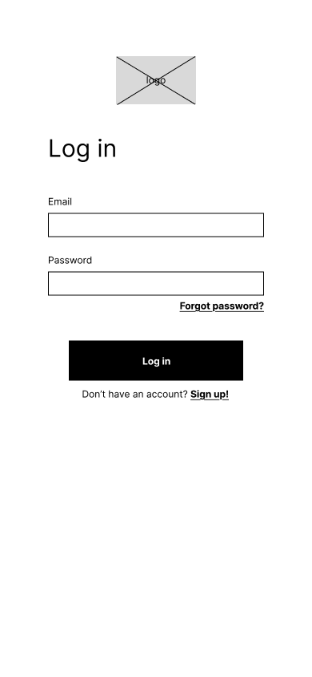
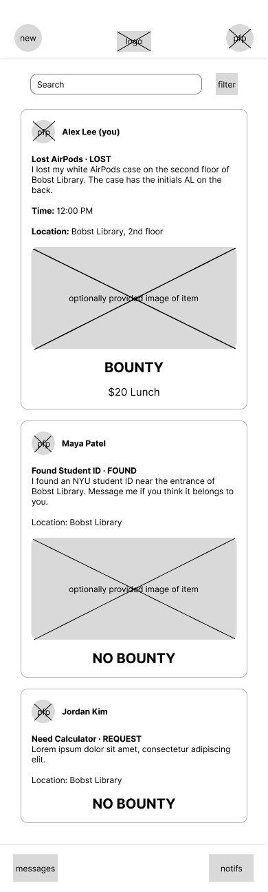
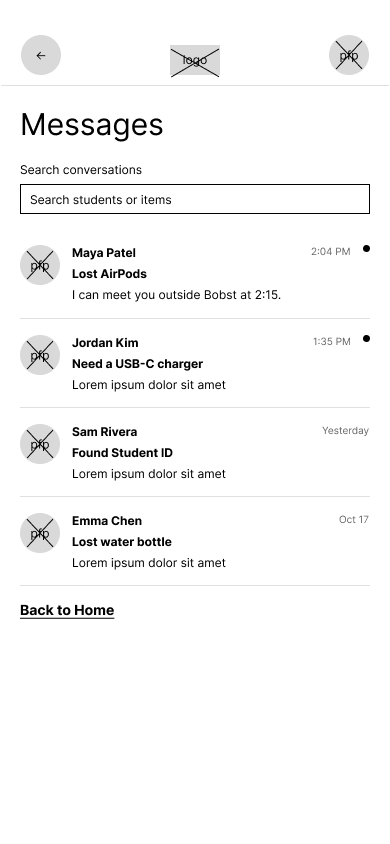
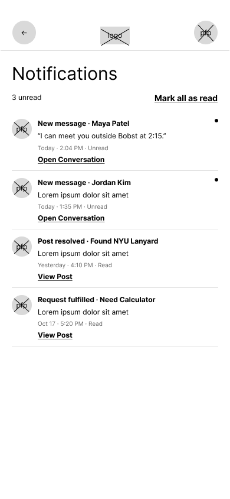
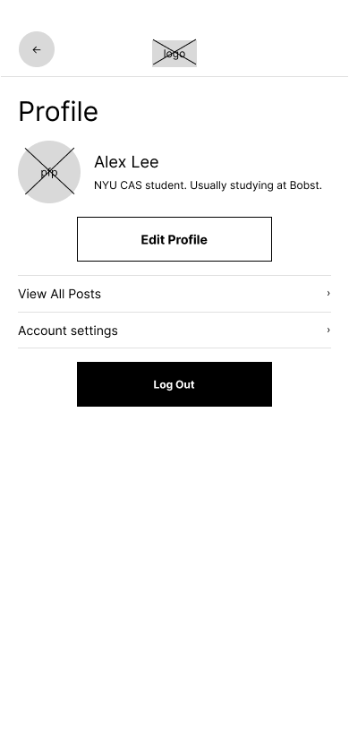

# Bounty - User Experience Design
## Interactive Prototype

[View the Bounty mobile prototype](https://www.figma.com/design/y3L4GQm6EEtOr8gmSc5yrH/Bounty---Wireframes-Prototype?t=yLVpIdUlW2OHREzg-1)

The prototype demonstrates account access, browsing and searching
posts, creating and managing posts, messaging, notifications, and
profile management.

## App Map

The app map shows the parent–child relationships between the
application's screens. Login leads to Home, which provides access
to posts, search, messages, notifications, and the user's profile.

## Account Access

### Login

Users enter their email and password to sign in. Links provide
access to account creation and password recovery.

### Login — Error State

An incorrect-email-or-password message appears after an unsuccessful
login attempt. Users can correct their credentials and try again
or begin password recovery.

### Sign Up

New users enter their name, email, password, and password confirmation
to create an account. Existing users can return to Login.

### Forgot Password

Users enter their NYU email address to request a password-reset link.
They can also return to Login.

### Password Reset Confirmation

Confirms that password-reset instructions have been sent.
Users can resend the email or return to Login.

## Home and Search

### Home

The Home screen displays Lost, Found, and Request posts. Each card
includes the author, item details, location, optional image, and
bounty information.

Users can open posts, create a post, search or filter the feed,
and access their profile, messages, and notifications.

### Search and Filters

Users can search by text and filter by post type, date range,
campus location, and bounty availability.

Apply Filters displays matching posts. Clear Filters removes
the selected restrictions.

### Search Results

Displays matching posts, the active filter summary, and the result
count. Users can open individual posts or clear the filters.

### Search Results — Empty State

Appears when no posts match the search or filters. Users can clear
the filters or return to Home.

## Viewing Posts

### View Post — My Post

Displays the signed-in user's post, including its description,
time, location, optional image, and bounty information.

The settings control opens the post-management menu.

### Post Settings

This dynamic menu opens from the settings control on the user's
own post. It provides Edit Post and Resolve Post actions.

### View Post — Other User

Displays another student's post and its details.
Message Student opens communication with the post's author.

## Creating Posts

### Create Post

Users choose Lost, Found, or Request and enter a title, description,
date, time, and location. An image is optional.

Lost-item posts can include a bounty. When enabled, the user enters
the reward in the bounty field. Publish Post submits the form.

### Create Post — Validation Error

Displays feedback when required information is missing.
The illustrated state identifies missing item-name and description
values so users can correct the form before publishing.

### Post Published Confirmation

Confirms that the post has been published and summarizes the item
and location. Users can view the post or return to Home.

## Editing and Resolving Posts

### Edit Post

Allows the owner to change a post's type, title, description,
date, time, location, image, and bounty information.

Save Changes submits the edits. Cancel leaves the editing flow.
Delete begins the deletion flow shown in the app map.

### Edit Confirmation

Confirms that the post has been updated. Users can view the edited
post or return to Home.

### Choose Bounty Receiver

During resolution of a post with a bounty, the owner chooses
a recipient from students they have messaged.

The screen explains that the recipient will be notified and
provides Confirm and Cancel controls.

### Post Resolved Confirmation

Confirms that the post has been marked as resolved and identifies
the item and location. Users can return to Home.

## Messages and Notifications

### Messages

Lists conversations with each student's name, associated item,
latest-message preview, and time or date. Indicators identify
unread conversations.

Users can search by student or item and open a conversation.

### Conversation — Lost AirPods

Displays the message history between two students about a post.
The summary identifies the item, location, and bounty.
View opens the associated post.

Users can enter a message and select Send.

### Messages — Empty State

Appears when there are no conversations. Browse Posts helps users
find a post and contact another student. Users can also return
to Home.

### Notifications

Displays updates about new messages, resolved posts, and fulfilled
requests. Each notification links to its conversation or post.

An unread count and indicators highlight new activity.
Mark all as read clears the unread status.

## Profile and Account Management

### Profile

Displays the user's picture, name, and biography.
Users can edit their profile, view their posts, open account
settings, or log out.

### Edit Profile

Allows users to upload a profile picture, change their name,
and edit an optional biography.

Users can save changes or cancel.

### My Posts — Active

Displays the user's active posts, including item details and
bounty information. The tabs switch between Active and Resolved
posts.

### My Posts — Resolved

Displays completed posts with a Resolved label.
Users can return to the Active tab to see ongoing posts.

### My Posts — Empty State

Appears when there are no active posts.
Create Post lets the user begin a new post.

### Account Settings

Allows users to update their email address and password.
The form includes email, old password, new password, and password
confirmation fields, with Save Changes and Cancel controls.

Email and password changes share one wireframe screen, although
the app map represents them as separate actions.

## Design Files

The `ux-design` directory contains the app map and individual
wireframe PNG exports.